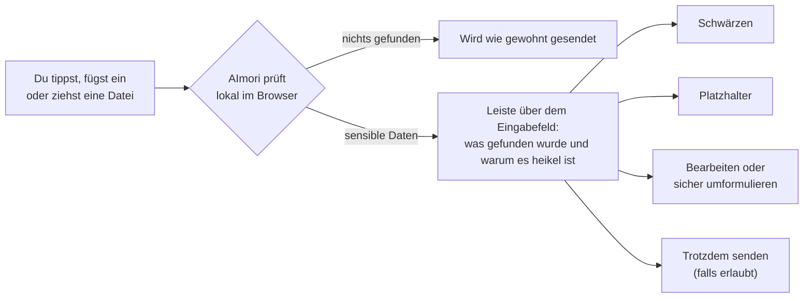

<p align="center">
  
</p>

<p align="center">
  <a href="https://chromewebstore.google.com/detail/lefajbhockjgdhaohnacgaggfepianjh"></a>
  <a href="LICENSE"></a>
  
  
  
</p>

<p align="center">
  <a href="#installieren">Installieren</a> ·
  <a href="#was-aimori-erkennt">Beispiele</a> ·
  <a href="#in-30-sekunden-ausprobieren">Ausprobieren</a> ·
  <a href="#screenshots">Screenshots</a> ·
  <a href="#häufige-fragen">Fragen</a> ·
  <a href="#für-unternehmen">Für Unternehmen</a> ·
  <a href="README.md">English</a>
</p>

<h3 align="center">Du fügst die IBAN einer Kundin in ChatGPT ein. AImori hält sie an, bevor sie deinen Browser verlässt.</h3>

**AImori ist eine kostenlose Open-Source-Browser-Erweiterung, die prüft, was du in KI-Chats tippst, einfügst oder hochlädst – lokal, bevor etwas gesendet wird.** Bank- und Kartennummern, AHV-, Ausweis- und Steuernummern, Passwörter in Code, Gesundheitsdaten, Kundenlisten: AImori hält das Senden an, zeigt den Fund und behebt ihn mit einem Klick.

Kein Server, kein Konto, keine Telemetrie. Die Erweiterung hat keinerlei Netzwerkzugriff.

## In zehn Sekunden

Du tippst das in ChatGPT und drückst die Eingabetaste:

```text
Schreib eine freundliche Zahlungserinnerung. Der offene Betrag geht an CH93 0076 2011 6238 5295 7.
```

AImori hält die Nachricht an und zeigt über dem Eingabefeld eine Leiste:

```text
[AImori]  Senden angehalten: IBAN erkannt
          Schwärzen · Platzhalter · Sicher umformulieren · Bearbeiten · Trotzdem senden
```

Mit **Platzhalter** kommt bei der KI nur das an:

```text
Schreib eine freundliche Zahlungserinnerung. Der offene Betrag geht an [IBAN_1].
```

Die KI schreibt die Erinnerung mit `[IBAN_1]` – und AImori zeigt dir die Antwort in der Erweiterung mit der echten IBAN. Der KI-Anbieter sieht die Nummer nie.

<p align="center">
  
</p>

## Installieren

| | |
|---|---|
| **Chrome und Edge** | [**AImori im Chrome Web Store hinzufügen**](https://chromewebstore.google.com/detail/lefajbhockjgdhaohnacgaggfepianjh) (der Eintrag ist nach der Prüfung durch Google erreichbar). In Edge auf Nachfrage Erweiterungen aus anderen Stores erlauben. Keine ZIP-Datei, kein Entwicklermodus, Updates kommen automatisch. |
| **Unternehmen** | Per Gruppenrichtlinie, Intune oder Registry mit der Erweiterungs-ID `lefajbhockjgdhaohnacgaggfepianjh` zwangsinstallieren, siehe [Für Unternehmen](#für-unternehmen). |
| **Aus dem Quellcode** | Erst bauen (siehe [Bauen und testen](#bauen-und-testen)), dann `chrome://extensions` bzw. `edge://extensions` → Entwicklermodus → „Entpackte Erweiterung laden“ → Ordner `extension`. Details: [Installation](docs/installation.md). |

## Was AImori erkennt

Echte Beispiele, geprüft mit der Erkennung von AImori selbst. Die rechte Spalte zeigt, was bei **Platzhalter** an die KI geht.

| Du fügst in den KI-Chat ein | AImori findet | Was gesendet wird |
|---|---|---|
| `Schreib eine freundliche Zahlungserinnerung. Der offene Betrag geht an CH93 0076 2011 6238 5295 7.` | IBAN (mit Prüfziffer) | `… geht an [IBAN_1].` |
| `Buch mir das Hotel, Karte 4242 4242 4242 4242, gültig bis 12/28.` | Kreditkartennummer (Luhn-Prüfung) | `… Karte [CC_VISA_1], gültig bis 12/28.` |
| `Füll das Formular für mich aus: AHV-Nummer 756.1234.5678.97` | AHV-Nummer | `… AHV-Nummer [CH_AHV_1]` |
| `const db = connect({ host: "db.example.com", password: "Example!2026" });` | Passwort in eingefügtem Code | `… password: "[CFG_PASSWORD_1]" });` |
| `Räum diese Liste auf: Anna Beispiel;anna@example.com;+44 20 7946 0958 …` | E-Mail-Adressen und Telefonnummern in einer Kundenliste | `Anna Beispiel;[EMAIL_1];[PHONE_E164_1] …` |
| `Fasse zusammen: Patientin Anna Beispiel, geboren 12.03.1985, Diagnose Diabetes Typ 2, verschrieben Metformin.` | Geburtsdatum und Gesundheitsdaten (Diagnose, Krankheit, Medikament) | derselbe Text, Gesundheitsangaben und Datum ersetzt |

Derselbe Wert bekommt im Gespräch immer denselben Platzhalter, so kann die KI mit dem Aufbau deines Textes weiterarbeiten. Namen wie „Anna Beispiel“ erkennt das optionale lokale KI-Modell. Alle Werte oben sind offizielle Testwerte oder erfunden.

Insgesamt über 200 Datentypen: IBAN und Karten, AHV-, Sozialversicherungs-, Steuer- und Ausweisnummern vieler Länder, Passzeilen (MRZ), Geburtsdaten, Kontaktdaten, API-Schlüssel und Tokens, Gesundheitsdaten, Personaldaten und Kundenlisten im Zusammenhang ([Kontext-Risiken](docs/kontext-risiken.md)). Ganze Liste: [Datentypen](docs/datentypen.md).

## In 30 Sekunden ausprobieren

1. [AImori installieren](#installieren).
2. ChatGPT, Claude, Gemini oder Copilot öffnen (schon offene Tabs neu laden).
3. Einen dieser offiziellen Testwerte einfügen und die Eingabetaste drücken:

| Testwert | Herkunft |
|---|---|
| `CH93 0076 2011 6238 5295 7` | Beispiel-IBAN der SWIFT IBAN Registry |
| `756.1234.5678.97` | Beispiel-AHV-Nummer der Zentralen Ausgleichsstelle |
| `4242 4242 4242 4242` | Öffentliche Testkarte von Stripe |

AImori hält das Senden an. **Schwärzen** macht daraus `[Finanzdaten]`, **Platzhalter** macht daraus `[IBAN_1]`. Nie mit echten Daten testen.

## So funktioniert es



- **Prüfziffern, wo es sie gibt:** Eine IBAN oder Kartennummer zählt nur mit gültiger Prüfziffer – das hält Fehlalarme klein.
- **Zusammenhang statt nur Muster:** Gesundheitsangaben, Personaldaten und Kundenlisten werden im Zusammenhang erkannt.
- **Optional lokale KI:** Ein mitgeliefertes ONNX-Modell findet Namen, Firmen und Adressen ([KI-Erkennung](docs/ki-erkennung.md)); mitgeliefertes Tesseract liest Text in eingefügten Screenshots ([Bilder](docs/bilder.md)). Beides läuft offline im Browser.
- **Training-Ampel:** Das Popup zeigt, ob die aktuelle KI-Seite Chats standardmässig zum Training nutzt, mit direktem Link zum Abschalten ([Training-Ampel](docs/ki-training.md)).

## Screenshots

<table>
  <tr>
    <td width="50%"></td>
    <td width="50%"></td>
  </tr>
  <tr>
    <td><b>Senden angehalten.</b> AImori zeigt den Fund, erklärt das Risiko und schwärzt mit einem Klick.</td>
    <td><b>Hinweis beim Tippen.</b> Ein ruhiger Hinweis, sobald sensible Daten im Eingabefeld stehen.</td>
  </tr>
  <tr>
    <td></td>
    <td></td>
  </tr>
  <tr>
    <td><b>Popup.</b> Schutzstatus, lokale Zähler und ob die KI-Seite deine Chats standardmässig zum Training nutzt – mit Link zum Abschalten.</td>
    <td><b>Einstellungen.</b> Erkennung, Seiten und Ausnahmen, Bilder und Dateien, Datenschutz – alles durchsuchbar.</td>
  </tr>
</table>

<sub>Die Screenshots zeigen eine Demo-Chatseite mit synthetischen Testwerten.</sub>

## Wo es wirkt

| | |
|---|---|
| **KI-Seiten** | ChatGPT, Claude, Gemini, Microsoft Copilot und Microsoft 365 Copilot. Auf über 60 weiteren KI-Seiten können Organisationen einen Hinweis zeigen oder die Seite sperren (optionale Berechtigung, [KI-Seiten](docs/ki-seiten.md)). |
| **Browser** | Google Chrome und Microsoft Edge ab Version 110. Microsoft lässt auf Copilot in Edge keine Erweiterungen laufen – dort schützt AImori in Chrome. |
| **Sprachen** | Deutsch, Englisch, Französisch, Italienisch, Portugiesisch, Spanisch. |

## Datenschutz

| | |
|---|---|
| **Was AImori sieht** | Den Text, den du auf unterstützten KI-Seiten tippst, einfügst oder hochlädst – geprüft im Browser, im Arbeitsspeicher. |
| **Was es speichert** | Deine Einstellungen und Tageszähler (Seite, Kategorie, Entscheidung) für 90 Tage. Nie Texte, Funde oder Dateinamen. |
| **Was es sendet** | Nichts. Es gibt keinen Server, und die Sicherheitsrichtlinie der Erweiterung verbietet Netzwerkverbindungen (`connect-src 'none'`, durch Tests abgesichert). |

Selbst nachprüfen: Die Berechtigungen stehen in [`extension/manifest.json`](extension/manifest.json), die Datenschutzerklärung in [PRIVACY.md](PRIVACY.md), und jede Zeile Code liegt in diesem Repository.

## Grenzen (bewusst)

AImori hilft gegen Versehen, es ist kein vollständiges DLP-System. Kein Server, keine Telemetrie, kein Desktop-Agent. Nicht geschützt: Desktop- und Handy-Apps der KI-Anbieter, andere Browser, nicht unterstützte KI-Seiten, gezielt verschleierte Daten. Getippter Text kann von der KI-Seite schon vor dem Senden gelesen werden (Entwürfe). Mehr dazu: [Was es tut und was nicht](docs/ueber.md) · Sicherheits-Auflagen und Restrisiken: [Design-Review](docs/sicherheit/design-review-mvp.md).

## Häufige Fragen

<details>
<summary><b>Liest oder verschickt AImori meine Prompts?</b></summary>

AImori liest sie lokal, um sie zu prüfen – das ist seine Aufgabe –, verschickt oder speichert sie aber nie. Die Erweiterung hat keinen Netzwerkzugriff und keinen Server, an den etwas gehen könnte.
</details>

<details>
<summary><b>Hält mich AImori von der Arbeit ab?</b></summary>

Nein. Du siehst immer, was gefunden wurde, und entscheidest: schwärzen, Platzhalter, bearbeiten oder trotzdem senden. Nur eine Organisation kann „Trotzdem senden“ auf ihren verwalteten Geräten abschalten.
</details>

<details>
<summary><b>Was kostet es?</b></summary>

Nichts, für Privatpersonen und für Firmen. AImori ist Open Source unter der GNU AGPL v3.
</details>

<details>
<summary><b>Schützt es auch die Desktop-Apps von ChatGPT oder Copilot?</b></summary>

Nein. AImori ist eine Browser-Erweiterung und wirkt auf den KI-Seiten in Chrome und Edge. Wer alles abdecken will, sperrt die Desktop-Apps und nutzt den Browser.
</details>

<details>
<summary><b>Und Fehlalarme?</b></summary>

Nummern zählen nur mit gültiger Prüfziffer, und du kannst einen Wert als „Kein sensibler Wert“ markieren oder einen Datentyp auf Warnen oder Aus stellen. Fehlalarm gefunden? Bitte als [Issue](https://github.com/henrimedeiros/aimori/issues) mit einem erfundenen Beispiel melden ([Fehlalarme](docs/fehlalarme.md)).
</details>

<details>
<summary><b>Warum Open Source?</b></summary>

Ein Werkzeug, das liest, was du in KI-Chats tippst, muss nachprüfbar sein. Jede und jeder kann kontrollieren, dass AImori sein Versprechen hält: kein Netzwerkzugriff, nichts gespeichert, nichts gesendet.
</details>

## Für Unternehmen

- **Zentrale Verwaltung** per Gruppenrichtlinie (ADMX/ADML für Chrome und Edge), Intune oder Registry-Skripte: [GPO](docs/deployment/gpo.md) · [Intune](docs/deployment/intune.md) · [Registry-Skripte](docs/deployment/registry-skripte.md) · [alle Richtlinien-Schlüssel](docs/einstellungen.md) · Beispiel `enterprise/example-policy.json`.
- **Zwangsinstallation** per `ExtensionInstallForcelist`: `lefajbhockjgdhaohnacgaggfepianjh;https://clients2.google.com/service/update2/crx`
- **Whitelabel:** eigener Name, eigenes Logo und eigene Farben per Richtlinie ([Branding](docs/branding.md)), für MSPs auch je Kunde ([Rollout-Anleitung](docs/fuer-unternehmen.md)).
- **Freigegebene und gesperrte KI-Tools**, [Regeln je Konto](docs/konto-regeln.md) für Firmen- und Privatkonto derselben KI.
- **Eigene Begriffe** – Kundennamen, Projekt-Codenamen, interne Domains – als gesalzene Prüfsummen geschützt ([Eigene Begriffe](docs/eigene-begriffe.md)).
- **Berichte nur mit Zahlen** für revDSG, DSGVO, HIPAA, ISO 27001 und Art. 4 EU AI Act ([Nachweise](docs/compliance/README.md)).

## Bauen und testen

Node.js 20 oder neuer. Installationsskripte von Paketen laufen nie (`.npmrc` setzt `ignore-scripts=true`).

```bash
npm ci --ignore-scripts
node scripts/build-ocr.mjs
node scripts/build-ki.mjs
npm test
npm run check
```

`npm run build` erzeugt ADMX/ADML und die erzeugte Doku neu. `node scripts/pack-store.mjs` baut, prüft und schreibt das Store-Paket `dist/aimori-<version>-chrome.zip` ([Store-Anleitung](docs/store/chrome-web-store.md)).

<details>
<summary><b>Aufbau des Repos</b></summary>

| Ordner | Inhalt |
|---|---|
| `extension/` | Erweiterung: `manifest.json`, `managed_schema.json`, `branding.js` (einzige Stelle mit dem Namen im Code), `engine/` (Erkennung, Pakete), `common/` (Richtlinie, Texte, Zähler), `content/` (Content Script, Seitenadapter), `ui/` (Dialog, Popup, Einstellungen), `_locales/` (en, de, fr, it, pt, es) |
| `enterprise/` | ADMX/ADML (Edge, Chrome; en-US, de-DE), PowerShell Deploy/Detect/Remove, Beispiel-Richtlinien |
| `muster/` | Signierter Gemeinschafts-Katalog für Erkennungsmuster |
| `scripts/` | ADMX- und Doku-Erzeuger, Prüfskript, Icon-Erzeuger, Store-Paket, E2E-Prüfung in Edge |
| `tests/` | Unit-Tests (node:test) |
| `docs/` | Doku, Übersicht in [docs/README.md](docs/README.md); Sicherheits-Reviews je Funktion unter `docs/sicherheit/` |

Marke: **AImori** („AI“ gross, „mori“ klein), Signet Helm-Schild. Der interne Code-Name ist neutral (`dlx`): Speicher-Schlüssel `dlx.*`, ADMX-Dateien `dlx-*.admx`, Richtlinien-Schlüssel ohne Produktnamen. Namenswechsel: `extension/branding.js` + `extension/_locales/*/messages.json`, dann `npm run build`.

</details>

<details>
<summary><b>Vorbild CyberDrain Check und Unterschiede</b></summary>

Aufbau von Richtlinien (`managed_schema.json`), Whitelabel-Objekt, Rollout-Ordner (ADMX, Deploy-/Detect-/Remove-Skripte) und Doku-Gliederung sind am Konzept von [CyberDrain Check](https://github.com/CyberDrain/Check) bzw. [docs.check.tech](https://docs.check.tech/) orientiert. Es wurde **kein Code und kein Text** übernommen – nur die Gliederung und das Konzept.

| | Check | AImori |
|---|---|---|
| Zweck | Phishing-Schutz für Microsoft-365-Anmeldeseiten | Datenleck-Schutz bei Eingaben an KI-Seiten |
| Netzwerk | Regel-Updates per URL, optional CIPP-Meldungen und Webhook | keinerlei Netzwerkzugriff; `reportingUrl` nur reserviert |
| Rechte | breite Seitenrechte (alle Seiten prüfen) | Content Scripts auf festen KI-Seiten; weitere Seiten nur als optionale Rechte nach Zustimmung |
| Protokoll | Aktivitäts-Log | nur Tageszähler (Seite, Kategorie, Entscheidung), 90 Tage |
| Logo | per URL | nur als data:-URI (kein Netz) |
| Erkennung | Regeln für Phishing-Merkmale | über 200 Datentypen mit Prüfziffern, Länderpakete, Kontext-Risiken, lokale KI, Texterkennung in Bildern, eigene Begriffe nur als gesalzene Prüfsummen ([Eigene Begriffe](docs/eigene-begriffe.md)) |

</details>

## Mitmachen

Erkennungsmuster sind als Pull-Request an `muster/katalog.json` willkommen ([so geht's](docs/muster-mitmachen.md)); für Code bitte zuerst ein Issue eröffnen. Siehe [CONTRIBUTING.md](CONTRIBUTING.md).

Sicherheitslücke gefunden? Bitte nach [SECURITY.md](SECURITY.md) melden, nicht als öffentliches Issue. Fragen und Fehler: [Issues](https://github.com/henrimedeiros/aimori/issues).

## Lizenz

Copyright (C) 2026 Die AImori-Autorinnen und -Autoren. Lizenziert unter der GNU Affero General Public License, Version 3 ([LICENSE](LICENSE)). Mitgelieferte Fremdkomponenten behalten ihre eigenen Lizenzen: [THIRD_PARTY_NOTICES.md](THIRD_PARTY_NOTICES.md).
