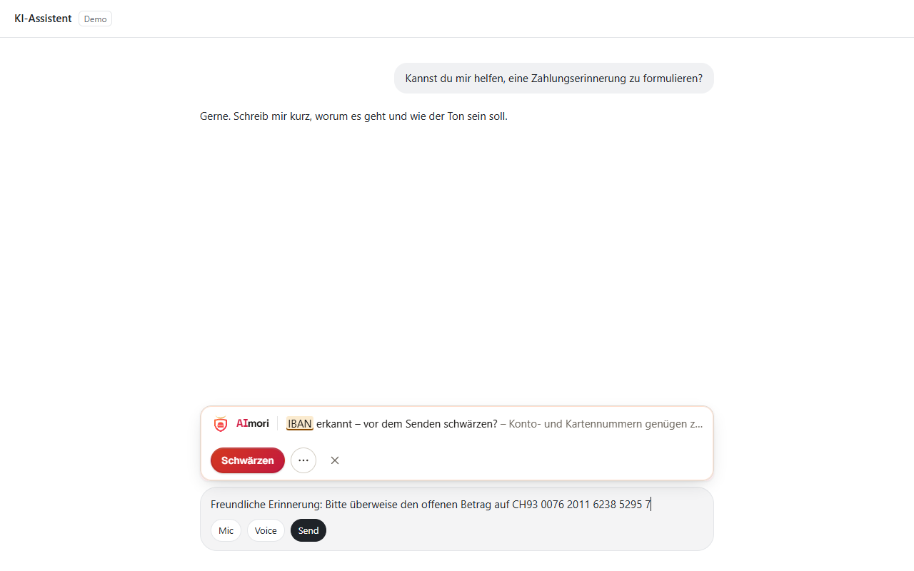
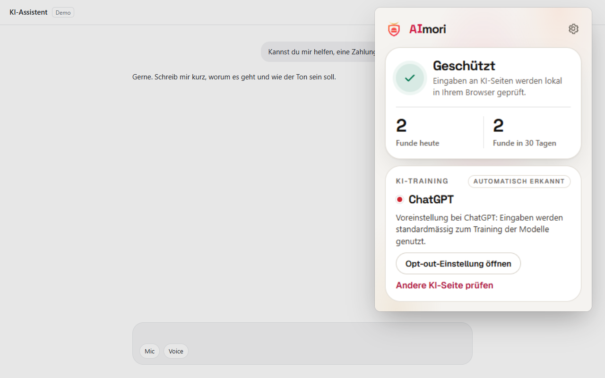
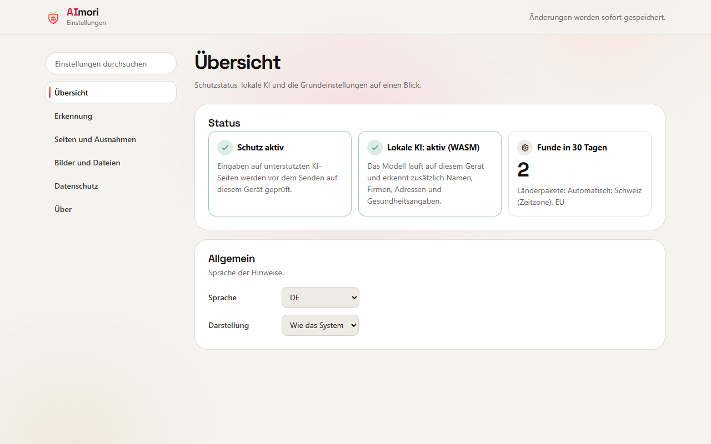

<p align="center">
  
</p>

<p align="center">
  <a href="https://chromewebstore.google.com/detail/lefajbhockjgdhaohnacgaggfepianjh"></a>
  <a href="LICENSE"></a>
  
  
</p>

<p align="center">
  <a href="#installieren">Installieren</a> ·
  <a href="#screenshots">Screenshots</a> ·
  <a href="#funktionen">Funktionen</a> ·
  <a href="#für-unternehmen">Für Unternehmen</a> ·
  <a href="#bauen-und-testen">Bauen</a> ·
  <a href="README.md">English</a>
</p>

**AImori prüft, was du in KI-Chats tippst, einfügst oder hochlädst, auf sensible Daten – lokal im Browser, bevor etwas gesendet wird.** IBAN, Kartennummern, AHV-, Ausweis- und Steuernummern, API-Schlüssel, Gesundheitsdaten: AImori hält das Senden an, zeigt den Fund und schwärzt ihn mit einem Klick.

Kein Server, kein Konto, keine Telemetrie. Die Erweiterung hat keinerlei Netzwerkzugriff (`connect-src 'none'`, durch Tests abgesichert).

## Installieren

| | |
|---|---|
| **Chrome und Edge** | [**AImori im Chrome Web Store hinzufügen**](https://chromewebstore.google.com/detail/lefajbhockjgdhaohnacgaggfepianjh) (der Eintrag ist nach der Prüfung durch Google erreichbar). In Edge auf Nachfrage Erweiterungen aus anderen Stores erlauben. |
| **Unternehmen** | Per Gruppenrichtlinie, Intune oder Registry mit der Erweiterungs-ID `lefajbhockjgdhaohnacgaggfepianjh` zwangsinstallieren, siehe [Für Unternehmen](#für-unternehmen). |
| **Aus dem Quellcode** | Erst bauen (siehe [Bauen und testen](#bauen-und-testen)), dann `chrome://extensions` bzw. `edge://extensions` → Entwicklermodus → „Entpackte Erweiterung laden“ → Ordner `extension`. Details: [Installation](docs/installation.md). |

## So funktioniert es

1. **Du tippst, fügst ein oder ziehst eine Datei** in ChatGPT, Claude, Gemini oder Copilot.
2. **AImori prüft es auf deinem Gerät** – mit Prüfziffern, wo es sie gibt, einem lokalen KI-Modell und lokaler Texterkennung für Bilder. Nichts verlässt den Browser.
3. **Du entscheidest:** schwärzen, Werte durch Platzhalter wie `[IBAN_1]` ersetzen, bearbeiten oder – wenn deine Organisation es erlaubt – trotzdem senden.

## Screenshots

<table>
  <tr>
    <td width="50%"></td>
    <td width="50%"></td>
  </tr>
  <tr>
    <td><b>Senden angehalten.</b> AImori zeigt den Fund, erklärt das Risiko und schwärzt mit einem Klick.</td>
    <td><b>Hinweis beim Tippen.</b> Ein ruhiger Hinweis, sobald sensible Daten im Eingabefeld stehen.</td>
  </tr>
  <tr>
    <td></td>
    <td></td>
  </tr>
  <tr>
    <td><b>Popup.</b> Schutzstatus, lokale Zähler und ob die KI-Seite deine Chats standardmässig zum Training nutzt – mit Link zum Abschalten.</td>
    <td><b>Einstellungen.</b> Erkennung, Seiten und Ausnahmen, Bilder und Dateien, Datenschutz – alles durchsuchbar.</td>
  </tr>
</table>

<sub>Die Screenshots zeigen eine Demo-Chatseite mit synthetischen Testwerten.</sub>

## Funktionen

| | |
|---|---|
| **Was erkannt wird** | Über 200 Datentypen, mit Prüfziffern, wo es sie gibt: IBAN und Kreditkarten, AHV-, Sozialversicherungs-, Steuer- und Ausweisnummern vieler Länder, Passzeilen (MRZ), Geburtsdaten, Kontaktdaten, API-Schlüssel, Passwörter und Tokens – auch in eingefügtem Code. Gesundheitsdaten, Personaldaten und Kundenlisten im Zusammenhang ([Kontext-Risiken](docs/kontext-risiken.md)). Ganze Liste: [Datentypen](docs/datentypen.md). |
| **Lokale KI und Bilder** | Optional Namen, Firmen und Adressen per mitgeliefertem ONNX-Modell und Texterkennung in eingefügten Screenshots per mitgeliefertem Tesseract. Beides läuft offline im Browser ([KI-Erkennung](docs/ki-erkennung.md), [Bilder](docs/bilder.md)). |
| **Was du tun kannst** | Schwärzen, [Platzhalter](docs/platzhalter.md) einsetzen und die KI-Antwort in der Erweiterung mit den echten Werten lesen, den Prompt bearbeiten oder, falls erlaubt, trotzdem senden. |
| **Training-Ampel** | Zeigt, ob die aktuelle KI-Seite Chats standardmässig zum Training nutzt, mit direktem Link zum Abschalten ([Training-Ampel](docs/ki-training.md)). |
| **Wo es wirkt** | ChatGPT, Claude, Gemini, Microsoft Copilot und Microsoft 365 Copilot. Auf über 60 weiteren KI-Seiten können Organisationen einen Hinweis zeigen oder die Seite sperren (optionale Berechtigung, [KI-Seiten](docs/ki-seiten.md)). |
| **Sprachen** | Deutsch, Englisch, Französisch, Italienisch, Portugiesisch, Spanisch. |

## Datenschutz

Deine Prompts verlassen dein Gerät nie. AImori speichert nur Tageszähler (Seite, Kategorie, Entscheidung) für 90 Tage – nie Texte, Funde oder Dateinamen. Es gibt keinen Server, an den etwas gehen könnte. Details: [PRIVACY.md](PRIVACY.md).

## Grenzen (bewusst)

AImori hilft gegen Versehen, es ist kein vollständiges DLP-System. Kein Server, keine Telemetrie, kein Desktop-Agent. Nicht geschützt: Desktop- und Handy-Apps der KI-Anbieter, andere Browser, nicht unterstützte KI-Seiten, gezielt verschleierte Daten. Getippter Text kann von der KI-Seite schon vor dem Senden gelesen werden (Entwürfe). Mehr dazu: [Was es tut und was nicht](docs/ueber.md) · Sicherheits-Auflagen und Restrisiken: [Design-Review](docs/sicherheit/design-review-mvp.md).

## Für Unternehmen

- **Zentrale Verwaltung** per Gruppenrichtlinie (ADMX/ADML für Chrome und Edge), Intune oder Registry-Skripte: [GPO](docs/deployment/gpo.md) · [Intune](docs/deployment/intune.md) · [Registry-Skripte](docs/deployment/registry-skripte.md) · [alle Richtlinien-Schlüssel](docs/einstellungen.md) · Beispiel `enterprise/example-policy.json`.
- **Whitelabel:** eigener Name, eigenes Logo und eigene Farben per Richtlinie ([Branding](docs/branding.md)), für MSPs auch je Kunde ([Rollout-Anleitung](docs/fuer-unternehmen.md)).
- **Freigegebene und gesperrte KI-Tools**, [Regeln je Konto](docs/konto-regeln.md) für Firmen- und Privatkonto derselben KI.
- **Eigene Begriffe** – Kundennamen, Projekt-Codenamen, interne Domains – als gesalzene Prüfsummen geschützt ([Eigene Begriffe](docs/eigene-begriffe.md)).
- **Berichte nur mit Zahlen** für revDSG, DSGVO, HIPAA, ISO 27001 und Art. 4 EU AI Act ([Nachweise](docs/compliance/README.md)).

Erweiterungs-ID im Chrome Web Store: `lefajbhockjgdhaohnacgaggfepianjh`

## Bauen und testen

Node.js 20 oder neuer. Installationsskripte von Paketen laufen nie (`.npmrc` setzt `ignore-scripts=true`).

```bash
npm ci --ignore-scripts
node scripts/build-ocr.mjs
node scripts/build-ki.mjs
npm test
npm run check
```

`npm run build` erzeugt ADMX/ADML und die erzeugte Doku neu. `node scripts/pack-store.mjs` baut, prüft und schreibt das Store-Paket `dist/aimori-<version>-chrome.zip` ([Store-Anleitung](docs/store/chrome-web-store.md)).

<details>
<summary><b>Aufbau des Repos</b></summary>

| Ordner | Inhalt |
|---|---|
| `extension/` | Erweiterung: `manifest.json`, `managed_schema.json`, `branding.js` (einzige Stelle mit dem Namen im Code), `engine/` (Erkennung, Pakete), `common/` (Richtlinie, Texte, Zähler), `content/` (Content Script, Seitenadapter), `ui/` (Dialog, Popup, Einstellungen), `_locales/` (en, de, fr, it, pt, es) |
| `enterprise/` | ADMX/ADML (Edge, Chrome; en-US, de-DE), PowerShell Deploy/Detect/Remove, Beispiel-Richtlinien |
| `muster/` | Signierter Gemeinschafts-Katalog für Erkennungsmuster |
| `scripts/` | ADMX- und Doku-Erzeuger, Prüfskript, Icon-Erzeuger, Store-Paket, E2E-Prüfung in Edge |
| `tests/` | Unit-Tests (node:test) |
| `docs/` | Doku, Übersicht in [docs/README.md](docs/README.md); Sicherheits-Reviews je Funktion unter `docs/sicherheit/` |

Marke: **AImori** („AI“ gross, „mori“ klein), Signet Helm-Schild. Der interne Code-Name ist neutral (`dlx`): Speicher-Schlüssel `dlx.*`, ADMX-Dateien `dlx-*.admx`, Richtlinien-Schlüssel ohne Produktnamen. Namenswechsel: `extension/branding.js` + `extension/_locales/*/messages.json`, dann `npm run build`.

</details>

<details>
<summary><b>Vorbild CyberDrain Check und Unterschiede</b></summary>

Aufbau von Richtlinien (`managed_schema.json`), Whitelabel-Objekt, Rollout-Ordner (ADMX, Deploy-/Detect-/Remove-Skripte) und Doku-Gliederung sind am Konzept von [CyberDrain Check](https://github.com/CyberDrain/Check) bzw. [docs.check.tech](https://docs.check.tech/) orientiert. Es wurde **kein Code und kein Text** übernommen – nur die Gliederung und das Konzept.

| | Check | AImori |
|---|---|---|
| Zweck | Phishing-Schutz für Microsoft-365-Anmeldeseiten | Datenleck-Schutz bei Eingaben an KI-Seiten |
| Netzwerk | Regel-Updates per URL, optional CIPP-Meldungen und Webhook | keinerlei Netzwerkzugriff; `reportingUrl` nur reserviert |
| Rechte | breite Seitenrechte (alle Seiten prüfen) | Content Scripts auf festen KI-Seiten; weitere Seiten nur als optionale Rechte nach Zustimmung |
| Protokoll | Aktivitäts-Log | nur Tageszähler (Seite, Kategorie, Entscheidung), 90 Tage |
| Logo | per URL | nur als data:-URI (kein Netz) |
| Erkennung | Regeln für Phishing-Merkmale | über 200 Datentypen mit Prüfziffern, Länderpakete, Kontext-Risiken, lokale KI, Texterkennung in Bildern, eigene Begriffe nur als gesalzene Prüfsummen ([Eigene Begriffe](docs/eigene-begriffe.md)) |

</details>

## Mitmachen

Erkennungsmuster sind als Pull-Request an `muster/katalog.json` willkommen ([so geht's](docs/muster-mitmachen.md)); für Code bitte zuerst ein Issue eröffnen. Siehe [CONTRIBUTING.md](CONTRIBUTING.md).

Sicherheitslücke gefunden? Bitte nach [SECURITY.md](SECURITY.md) melden, nicht als öffentliches Issue. Fragen und Fehler: [Issues](https://github.com/henrimedeiros/aimori/issues).

## Lizenz

Copyright (C) 2026 Die AImori-Autorinnen und -Autoren. Lizenziert unter der GNU Affero General Public License, Version 3 ([LICENSE](LICENSE)). Mitgelieferte Fremdkomponenten behalten ihre eigenen Lizenzen: [THIRD_PARTY_NOTICES.md](THIRD_PARTY_NOTICES.md).
