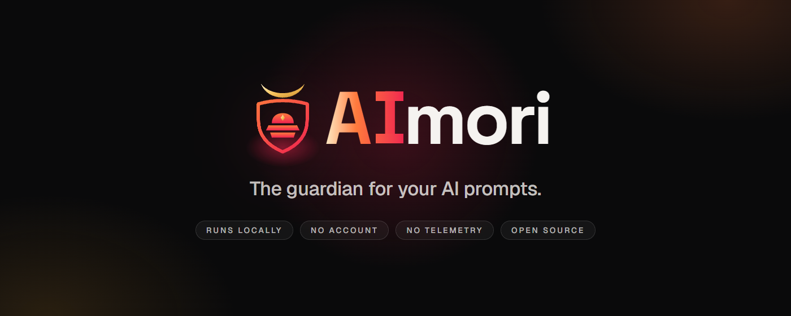
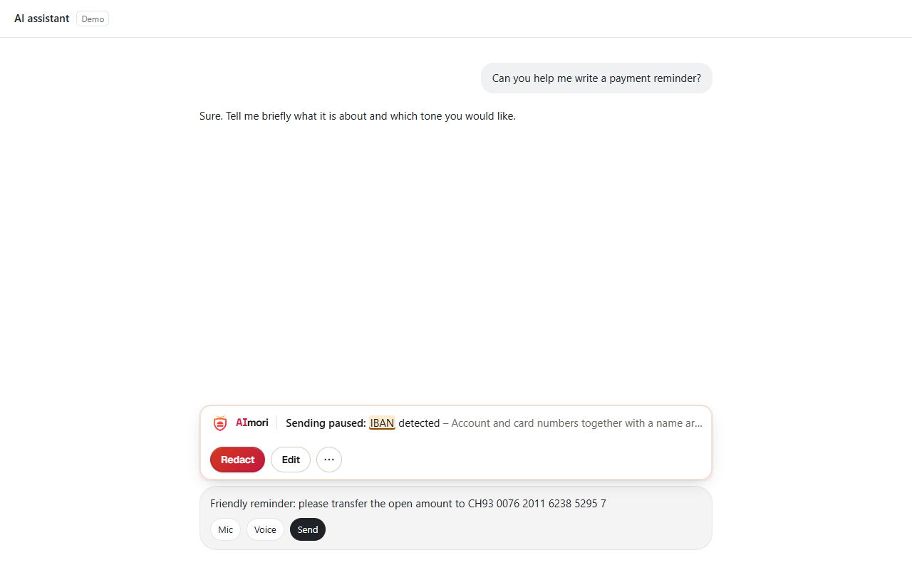
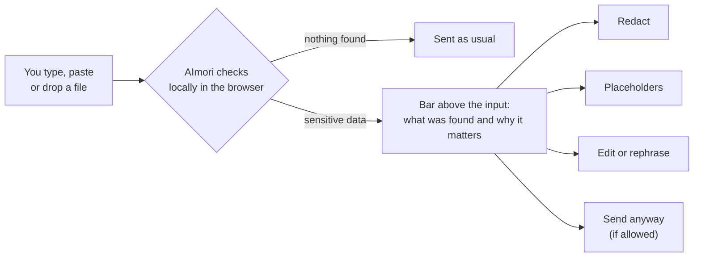
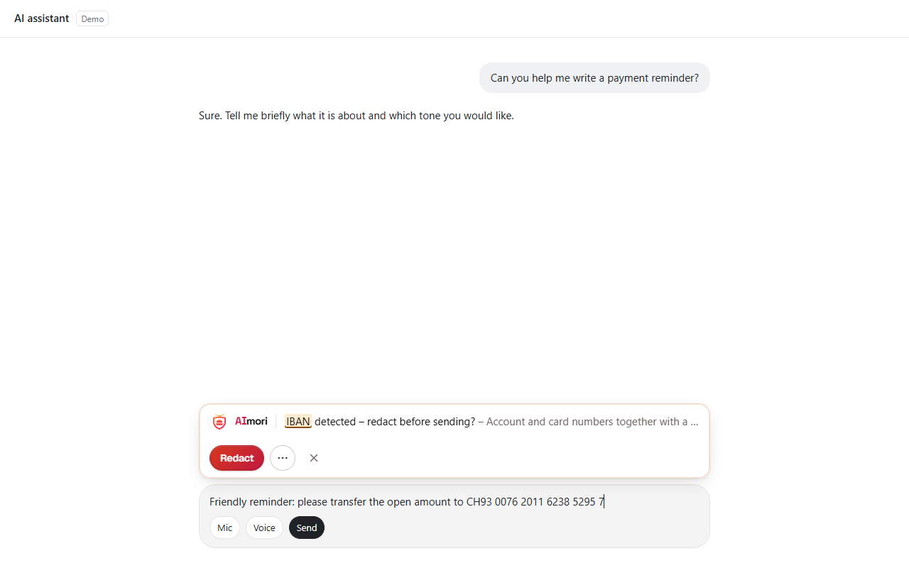
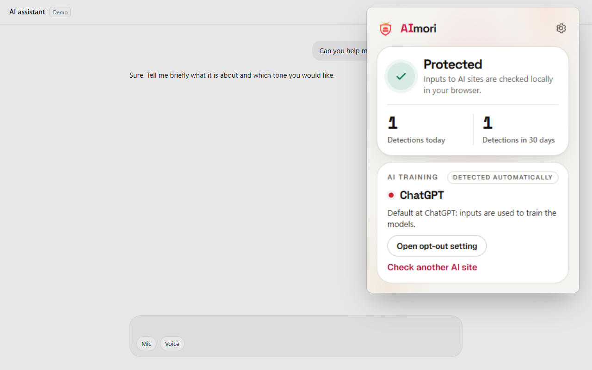
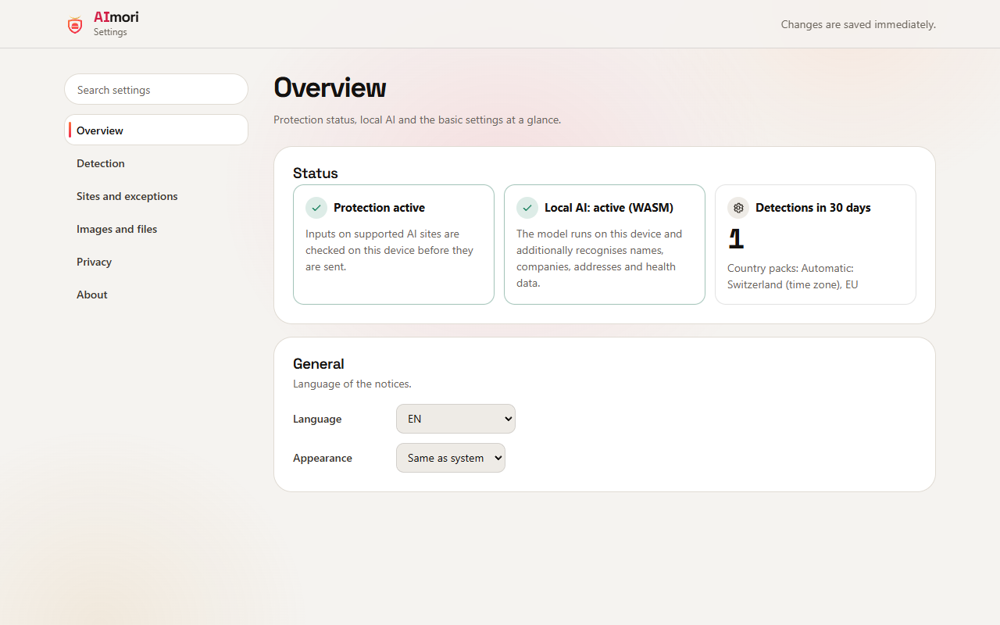

<p align="center">
  
</p>

<p align="center">
  <a href="https://chromewebstore.google.com/detail/lefajbhockjgdhaohnacgaggfepianjh"></a>
  <a href="LICENSE"></a>
  
  
  
</p>

<p align="center">
  <a href="#install">Install</a> ·
  <a href="#what-it-catches">Examples</a> ·
  <a href="#try-it-in-30-seconds">Try it</a> ·
  <a href="#screenshots">Screenshots</a> ·
  <a href="#faq">FAQ</a> ·
  <a href="#for-organisations">For organisations</a> ·
  <a href="LIESMICH.md">Deutsch</a>
</p>

<h3 align="center">You paste a customer's IBAN into ChatGPT. AImori stops it before it leaves your browser.</h3>

**AImori is a free, open-source browser extension that checks what you type, paste or upload into AI chats for sensitive data – locally, before anything is sent.** Bank and card numbers, ID and social security numbers, passwords in code, health data, customer lists: AImori pauses the send, shows what it found and lets you fix it with one click.

No server, no account, no telemetry. The extension has no network access at all.

## In ten seconds

You type this into ChatGPT and press Enter:

```text
Write a friendly payment reminder. The open amount goes to CH93 0076 2011 6238 5295 7.
```

AImori holds the message and shows a bar above the input field:

```text
[AImori]  Sending paused: IBAN detected
          Redact · Placeholders · Rephrase safely · Edit · Send anyway
```

With **Placeholders**, this is what actually reaches the AI:

```text
Write a friendly payment reminder. The open amount goes to [IBAN_1].
```

The AI writes the reminder with `[IBAN_1]` – and AImori shows you the answer with the real IBAN back in place, inside the extension. The AI provider never sees the number.

<p align="center">
  
</p>

## Install

| | |
|---|---|
| **Chrome and Edge** | [**Add AImori from the Chrome Web Store**](https://chromewebstore.google.com/detail/lefajbhockjgdhaohnacgaggfepianjh) (the listing goes live once Google's review is complete). In Edge, allow extensions from other stores when asked. No ZIP file, no developer mode, updates arrive automatically. |
| **Organisations** | Force-install with the extension ID `lefajbhockjgdhaohnacgaggfepianjh` via Group Policy, Intune or the registry, see [for organisations](#for-organisations). |
| **From source** | Build first (see [Build and test](#build-and-test)), then `chrome://extensions` or `edge://extensions` → developer mode → "Load unpacked" → select the `extension` folder. Details: [installation](docs/installation.md). |

## What it catches

Real examples, checked with AImori's own detection engine. The right-hand column is what the AI receives when you choose **Placeholders**.

| You paste into the AI chat | AImori finds | What gets sent |
|---|---|---|
| `Write a friendly payment reminder. The open amount goes to CH93 0076 2011 6238 5295 7.` | IBAN (with checksum) | `… goes to [IBAN_1].` |
| `Book the hotel for me, card 4242 4242 4242 4242, expiry 12/28.` | Credit card number (Luhn check) | `… card [CC_VISA_1], expiry 12/28.` |
| `Fill in the form for me: AHV number 756.1234.5678.97` | Swiss social security number (AHV) | `… AHV number [CH_AHV_1]` |
| `const db = connect({ host: "db.example.com", password: "Example!2026" });` | Password inside pasted code | `… password: "[CFG_PASSWORD_1]" });` |
| `Clean up this list: Anna Example;anna@example.com;+44 20 7946 0958 …` | Email addresses and phone numbers in a customer list | `Anna Example;[EMAIL_1];[PHONE_E164_1] …` |
| `Summarise: patient Anna Example, born 12.03.1985, diagnosis type 2 diabetes, prescribed metformin.` | Date of birth and health data (diagnosis, condition, medication) | the same text with the health terms and date replaced |

The same value always gets the same placeholder in a conversation, so the AI can still work with the structure of your text. Names like "Anna Example" are recognised by the optional local AI model. All values above are official test values or made up.

More than 200 data types in total: IBANs and cards, national ID, social security and tax numbers of many countries, passport lines (MRZ), dates of birth, contact data, API keys and tokens, health data, HR records and customer lists in context. Full list: [data types](docs/datentypen.md).

## Try it in 30 seconds

1. [Install AImori](#install).
2. Open ChatGPT, Claude, Gemini or Copilot (reload tabs that were already open).
3. Paste one of these official test values and press Enter:

| Test value | Source |
|---|---|
| `CH93 0076 2011 6238 5295 7` | Example IBAN of the SWIFT IBAN Registry |
| `756.1234.5678.97` | Example AHV number of the Swiss Central Compensation Office |
| `4242 4242 4242 4242` | Public test card number of Stripe |

AImori pauses the send. Choose **Redact** and the value becomes `[Financial data]`; choose **Placeholders** and it becomes `[IBAN_1]`. Never test with real data.

## How it works



- **Checksums where they exist:** an IBAN or card number only counts if its check digit is valid, which keeps false alarms down.
- **Context, not just patterns:** health terms, HR data and customer lists are recognised in context.
- **Optional local AI:** a bundled ONNX model finds names, companies and addresses; bundled Tesseract reads text in pasted screenshots. Both run offline in your browser.
- **AI training indicator:** the popup shows whether the current AI site uses your chats for training by default, with a direct link to the opt-out.

## Screenshots

<table>
  <tr>
    <td width="50%"></td>
    <td width="50%"></td>
  </tr>
  <tr>
    <td><b>Sending paused.</b> AImori shows what it found and why it matters, and redacts it with one click.</td>
    <td><b>Notice while typing.</b> A quiet hint as soon as sensitive data appears in the input.</td>
  </tr>
  <tr>
    <td></td>
    <td></td>
  </tr>
  <tr>
    <td><b>Popup.</b> Protection status, local counters and whether the AI site trains on your chats by default, with a link to the opt-out.</td>
    <td><b>Settings.</b> Detection, sites and exceptions, images and files, privacy – all searchable.</td>
  </tr>
</table>

<sub>Screenshots show a demo chat page with synthetic test values.</sub>

## Where it works

| | |
|---|---|
| **AI sites** | ChatGPT, Claude, Gemini, Microsoft Copilot and Microsoft 365 Copilot. On over 60 other AI sites, organisations can show a notice or block the site (optional permission). |
| **Browsers** | Google Chrome and Microsoft Edge, version 110 or later. Microsoft does not let extensions run on Copilot in Edge – there, AImori protects you in Chrome. |
| **Languages** | English, German, French, Italian, Portuguese, Spanish. |

## Privacy

| | |
|---|---|
| **What AImori sees** | The text you type, paste or upload on supported AI sites – checked in your browser, in memory. |
| **What it stores** | Your settings and daily counters (site, data category, decision) for 90 days. Never your text, the values it found or file names. |
| **What it sends** | Nothing. There is no server, and the extension's content security policy forbids network connections (`connect-src 'none'`, enforced by tests). |

Check it yourself: the permissions are in [`extension/manifest.json`](extension/manifest.json), the policy in [PRIVACY.md](PRIVACY.md), and every line of code is in this repository.

AImori helps against mistakes. It is not a full data loss prevention system: desktop and mobile apps of AI providers, other browsers and deliberately disguised data are out of scope. More in [what it does and what it does not](docs/ueber.md).

## FAQ

<details>
<summary><b>Does AImori read or upload my prompts?</b></summary>

It reads them locally to check them – that is its job – but it never sends or stores them. The extension has no network access and no server to send anything to.
</details>

<details>
<summary><b>Will it block me from working?</b></summary>

No. You always see what was found and decide: redact, use placeholders, edit or send anyway. Only an organisation can turn "send anyway" off for its managed devices.
</details>

<details>
<summary><b>What does it cost?</b></summary>

Nothing, for individuals and for companies. AImori is open source under the GNU AGPL v3.
</details>

<details>
<summary><b>Does it protect the ChatGPT or Copilot desktop apps?</b></summary>

No. AImori is a browser extension and works on the AI sites in Chrome and Edge. Organisations that want full coverage can block the desktop apps and use the browser.
</details>

<details>
<summary><b>What about false alarms?</b></summary>

Numbers only count when their check digit is valid, and you can mark a value as "Not sensitive" or set a data type to warn or off. Found a false alarm? Please open an [issue](https://github.com/henrimedeiros/aimori/issues) with a made-up example.
</details>

<details>
<summary><b>Why open source?</b></summary>

A tool that reads what you type into AI chats has to be verifiable. Anyone can check that AImori keeps its promise: no network access, nothing stored, nothing sent.
</details>

## For organisations

- **Central management** via Group Policy (ADMX/ADML for Chrome and Edge), Intune or registry scripts: [GPO](docs/deployment/gpo.md) · [Intune](docs/deployment/intune.md) · [registry scripts](docs/deployment/registry-skripte.md) · [all policy keys](docs/einstellungen.md).
- **Force-install** with `ExtensionInstallForcelist`: `lefajbhockjgdhaohnacgaggfepianjh;https://clients2.google.com/service/update2/crx`
- **White-label:** your own name, logo and colours per policy ([branding](docs/branding.md)), also per customer for MSPs ([rollout guide](docs/fuer-unternehmen.md)).
- **Allowed and blocked AI tools**, [rules for business and personal accounts](docs/konto-regeln.md) of the same AI.
- **Your own terms** – customer names, project code names, internal domains – protected as salted hashes ([own terms](docs/eigene-begriffe.md)).
- **Numbers-only reports** for GDPR, Swiss FADP, HIPAA, ISO 27001 and Art. 4 EU AI Act ([compliance](docs/compliance/README.md)).

## Build and test

Requires Node.js 20 or newer. Package install scripts are never run (`.npmrc` sets `ignore-scripts=true`).

```bash
npm ci --ignore-scripts
node scripts/build-ocr.mjs
node scripts/build-ki.mjs
npm test
npm run check
```

`npm run build` regenerates the ADMX/ADML templates and the generated docs. `node scripts/pack-store.mjs` builds, verifies and writes the Chrome Web Store package to `dist/` ([store guide](docs/store/chrome-web-store.md)).

<details>
<summary><b>Repository layout</b></summary>

| Folder | Content |
|---|---|
| `extension/` | The extension: manifest, detection engine, content scripts, UI, locales (en, de, fr, it, pt, es) |
| `enterprise/` | ADMX/ADML templates, PowerShell deploy/detect/remove scripts, example policies |
| `muster/` | Signed community pattern catalogue |
| `scripts/` | Build, check, packaging and end-to-end test scripts |
| `tests/` | Unit tests (`node:test`) |
| `docs/` | Documentation (German), overview in [docs/README.md](docs/README.md) |

</details>

## Contributing

Detection patterns are welcome as pull requests to `muster/katalog.json` ([how it works](docs/muster-mitmachen.md)); for code, please open an issue first. See [CONTRIBUTING.md](CONTRIBUTING.md).

Found a security issue? Please follow [SECURITY.md](SECURITY.md) and do not open a public issue. Questions and bugs: [issues](https://github.com/henrimedeiros/aimori/issues).

## License

Copyright (C) 2026 The AImori authors.

This program is free software: you can redistribute it and/or modify it under the terms of the GNU Affero General Public License as published by the Free Software Foundation, version 3. It is distributed in the hope that it will be useful, but WITHOUT ANY WARRANTY. See [LICENSE](LICENSE).

Bundled third-party components (Tesseract, ONNX Runtime Web, tokenizers, model, fonts) keep their own licenses: [THIRD_PARTY_NOTICES.md](THIRD_PARTY_NOTICES.md).
