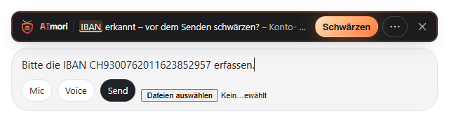

# Warnleiste anpassen: hell, dunkel, kompakt

Stand 17.10.2026. Die Warnleiste über dem Eingabefeld lässt sich anpassen. Nur das Aussehen ändert sich: Prüfung, Knöpfe und Entscheidungen bleiben gleich. Design-Review: [design-review-warnleiste-anpassbar.md](sicherheit/design-review-warnleiste-anpassbar.md).

## Einstellungen

| Schlüssel | Werte | Standard | Wirkung |
|---|---|---|---|
| `barTheme` | `auto`, `light`, `dark` | `auto` | `auto` folgt dem Hintergrund der KI-Seite (heller Grund → helle Leiste, dunkler Grund → dunkle). `light`/`dark` erzwingen die Farbe. |
| `barCompact` | `auto`, `on`, `off` | `auto` | Kompakt: 44 statt 56 px hoch, Knöpfe 30 statt 36 px, Signet 24 px. `auto` = kompakt, wenn die Leiste schmaler als 640 px ist (kleine Bildschirme, 200 % Zoom, schmale Fenster). |

- **Benutzer:** Einstellungen → Übersicht → „Warnleiste“ (Farbe der Leiste, Kompakt). Gespeichert wird nur der gewählte Wert in `chrome.storage.local`.
- **Unternehmen:** dieselben Schlüssel als Richtlinie (ADMX/ADML, Intune, [Einstellungen](einstellungen.md)). Per Richtlinie gesetzt, sind die Felder gesperrt (Schloss). Ein ungültiger Wert gilt als `auto`; die Einstellungsseite zeigt „Ungültiger Wert in der Richtlinie, Standard aktiv“.
- Was kompakt bleibt: Kernsatz, erkannte Datenart, alle Entscheidungsknöpfe und „Mehr erfahren“. Nichts wird ausgeblendet: Die kurze Erklärung je Gruppe steht hinten im Text, wird bei Platzmangel mit „…“ gekürzt und bleibt vollständig für Screenreader und als Tooltip.
- Marke: Signet und Wortmarke AImori bleiben in jeder Variante sichtbar (Signet nie unter 24 px, Markenvorgabe).
- Die Werte gehen nur an den erweiterungseigenen Leisten-Frame, nie an die KI-Seite oder ein Content Script. Nichts wird gesendet.

## Bilder

| Variante | Bild |
|---|---|
| Hell |  |
| Dunkel |  |
| Kompakt hell |  |
| Kompakt dunkel |  |
| Kompakt automatisch (640 px) |  |

Erzeugt mit dem E2E-Schritt `warnleiste` auf der lokalen ChatGPT-Attrappe (offizielle Test-IBAN, kein Netz): `E2E_NUR=warnleiste E2E_BILDER=<Ordner> node scripts/e2e/e2e.mjs`.

## Vorschlag für die Website (nicht veröffentlicht)

Nur Vorschlag; übernehmen und veröffentlichen entscheiden die Maintainer.

- DE: „Passt sich an: Die Warnleiste erscheint hell, dunkel oder passend zur Seite – und auf kleinen Bildschirmen kompakt, ohne dass ein Knopf fehlt.“
- DE (Unternehmen): „Farbe und kompakte Darstellung lassen sich per Gruppenrichtlinie oder Intune vorgeben.“
- EN: „Fits in: the warning bar shows light, dark or matching the page – and compact on small screens, without losing a single button.“
- EN (business): „Colour and compact mode can be set centrally via Group Policy or Intune.“
